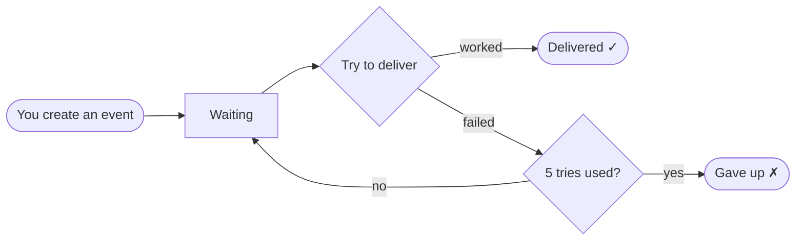
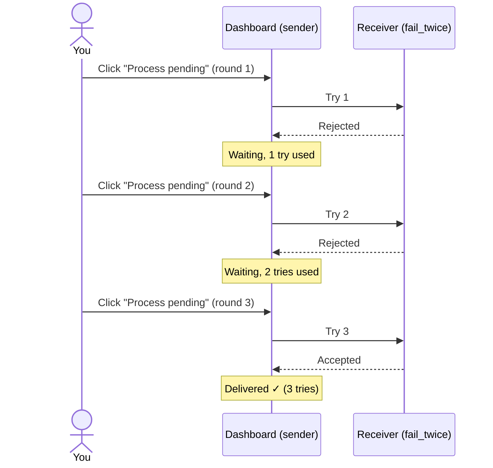
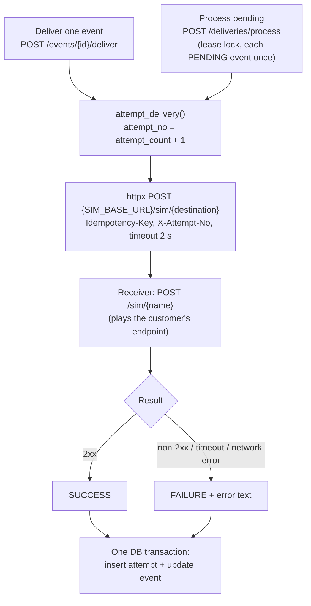

# Webhook Delivery Dashboard

**Live app:** https://webhook-dashboard-2x9d.onrender.com
The first visit after a quiet period can take 30–60 seconds to load (free hosting wakes up). After that it's fast.

---

## What is this?

When something happens in one system — say, an order is placed — it often needs to tell another system about it. That message is called an **event**, and sending it is a **delivery**.

Deliveries don't always work the first time: the other side may be down, busy, or slow. This dashboard shows how a careful sender handles that:

- It **tries to deliver** each event and **records every try** (when, and whether it worked).
- If a try fails, it **tries again later** — but **at most 5 times**, then it gives up.
- If the other side takes too long (**more than 2 seconds**), it stops waiting and counts that as a failed try.
- If the same event is sent twice by mistake, it is **not stored twice**.
- Nothing is lost if you refresh the page or the server restarts.

Think of a courier: they knock on the door; if nobody answers they come back later; after 5 visits they return the parcel. Every visit goes in the logbook.

---

## Assumptions

These are the choices behind how the demo behaves (decision numbers refer to [`SPEC.md`](SPEC.md)).

**About events**
- **You choose each event's name** (`event_id`). The same name always means the same event, so sending it twice doesn't create a second one. (D10, D11)
- **An event can't be edited once created.** Sending the same name with different content is refused; use a new name instead. This guarantees a retry always sends exactly what the first try sent. (D2, D10)
- **Each event goes to one destination,** chosen when you create it. (D6, D13)
- **Creating an event doesn't send it.** Sending only happens when you click **Deliver** or **Process pending**, so every step is visible. (D5)

**About delivery and retries**
- **Every failure is treated as possibly temporary** and is tried again, up to **5 tries in total**. The demo doesn't distinguish "try later" errors from "never going to work" errors. (D14, D18)
- **Taking longer than 2 seconds counts as a failure.** The sender stops waiting and records a timeout. (D22)
- **Retries happen when you click,** not on a timer, and there's no waiting period between tries. In a real system a background job would retry on its own, waiting longer after each failure. (D20, D24)
- **Only one Process pending round runs at a time,** even across browser tabs. (D21)

**About the demo itself**
- **The four destinations are pretend receivers** built into the same app, with fixed behaviour. A real system would send to each customer's own web address. (D22)
- **There is no login.** Anyone with the link can create events or reset the demo, and everyone shares the same data. (D8, D27)
- **Content must be JSON** (data in `{ "key": value }` form), and names may contain only letters, digits, `-` and `_`. (D16)

---

## Words used on the page

| Word | Meaning |
|---|---|
| **Event** | One message to deliver, with a name you choose (its `event_id`) and some content. |
| **Destination** | Where the event goes. This demo has four pretend receivers with fixed behaviour (below). |
| **Attempt** | One try at delivering. Each one is recorded. |
| **Process pending** | "Try again now for everything not yet delivered" — one more try per waiting event. |
| **Waiting** (`PENDING`) | Not delivered yet; will be tried again. |
| **Delivered** (`SUCCEEDED`) | Done. It won't be sent again. |
| **Gave up** (`FAILED`) | Failed 5 times. It won't be tried again. |

### The four pretend destinations

| Destination | What it does | Result |
|---|---|---|
| `always_succeed` | Accepts every delivery | Delivered on the 1st try |
| `fail_twice` | Rejects the first two tries, accepts from the third | Delivered on the 3rd try |
| `always_fail` | Rejects every delivery | Gives up after 5 tries |
| `slow` | Takes 5 seconds to answer — longer than the 2-second limit | Every try times out; gives up after 5 |

---

## How an event's status changes



A failed try sends the event back to **Waiting** until the next try (the next click of **Deliver** or **Process pending**). After the 5th failed try it stops for good.

---

## Example: the `fail_twice` destination

`fail_twice` rejects the first two tries and accepts the third. Here's what you see when you click **Process pending** three times:



| Click | Try | Receiver says | Status after |
|---|---|---|---|
| Process pending #1 | 1 | Rejected | Waiting |
| Process pending #2 | 2 | Rejected | Waiting |
| Process pending #3 | 3 | Accepted | **Delivered** |

**Get history** for that event then shows all three tries with their times and results. Clicking **Deliver** on it afterwards is refused — it's already delivered.

---

## User guide

### The page, top to bottom

| Section | What to do | What you'll see |
|---|---|---|
| **Create event** | An `event_id` is filled in for you. Edit the content if you like, pick a destination, click **Create event**. | `HTTP 201` = created. Sending the same id and content again gives `HTTP 200` with `"duplicate": true` (nothing new is stored). Same id with *different* content is refused (`HTTP 422`). |
| **Deliver** | Type an `event_id`, click **Deliver**. | One try, right now, and its result. A delivered or given-up event is refused (`HTTP 409`). |
| **Event history** | Type an `event_id`, click **Get history**. | The event and a table of every try: number, time, result, and the reason if it failed. |
| **Process pending** | Click it. | One more try for **every** waiting event, and a count of how many were delivered, gave up, or are still waiting. |
| **Reset demo** | Click it. | Everything is cleared and the 4 starting events come back. |
| **Events** | — | All events with their status and number of tries. Updates after every action. |

### Try it in 2 minutes

The page starts with four events, one per destination (`seed-always-succeed`, `seed-fail-twice`, `seed-always-fail`, `seed-slow`).

1. Click **Process pending** 3 times. `seed-always-succeed` is **Delivered** after the 1st click, `seed-fail-twice` after the 3rd.
2. Click **Process pending** 2 more times. `seed-always-fail` and `seed-slow` reach 5 tries and **Gave up**.
3. **Get history** for `seed-slow`: every try says `timeout after 2s`.
4. **Create event** with any id, then click **Create event** again without changing anything: it's recognised as a duplicate. Change the content and try again with the same id: refused.
5. Open the page in a second tab. Click **Process pending** in both tabs quickly: the second one is told a round is already running (`HTTP 409`). Only one round runs at a time.
6. Click **Reset demo** to start over.

---

# For developers

Full design, decisions (D1–D28) and the AI usage log: [`SPEC.md`](SPEC.md). Swagger UI: `/docs`.

## Delivery flow



`SUCCEEDED` and `FAILED` are terminal: `/deliver` on them returns `409` and makes no attempt.

### Destinations (simulated receivers)
One route in the same app, `POST /sim/{name}`. It stands in for the customer's webhook URL; `SIM_BASE_URL` is the only setting that points at it.

| Destination | Behavior |
|---|---|
| `always_succeed` | 200 |
| `fail_twice` | 500 on attempts 1–2 (reads `X-Attempt-No`), 200 after |
| `always_fail` | 500 |
| `slow` | waits 5 s → always exceeds the 2 s timeout |

---

## API

| Method & path | What it does | Main responses |
|---|---|---|
| `POST /events` | Create `{event_id, payload, destination}` | 201 new · 200 exact duplicate (`duplicate: true`, current status) · 422 same id + different payload/destination · 422 invalid input |
| `POST /events/{id}/deliver` | One attempt now | 200 (attempt `SUCCESS` or `FAILURE` — a failed attempt is data, not an error) · 409 `already_succeeded` / `already_failed` / `delivery_conflict` · 404 |
| `GET /events` | List, newest first | 200 |
| `GET /events/{id}` | Event, payload and all attempts | 200 · 404 |
| `POST /deliveries/process` | One retry round: one attempt for every `PENDING` event, oldest first | 200 `{processed, succeeded, failed, still_pending}` · 409 `process_already_running` |
| `POST /admin/reset` | Clear all data, reseed 4 demo events | 200 `{reset: true, seeded: 4}` |
| `POST /sim/{name}` | Simulated receiver | see above |
| `GET /health` | DB check | 200 · 503 |

Database unreachable → `503 database_unavailable` on any endpoint.

---

## Data model (PostgreSQL)

| Table | Columns | Key rules |
|---|---|---|
| `events` | id, **event_id** (client-supplied), payload (jsonb), destination, status, attempt_count, created_at, updated_at | `event_id` unique |
| `delivery_attempts` | id, event_pk → events.id, attempt_no, attempted_at, outcome, error | **unique (event_pk, attempt_no)** |
| `process_lock` | id (always 1), owner, locked_until | one row = the Process lease |

---

## Retry policy and guarantees

- **Bounded retries:** `MAX_ATTEMPTS` (env, default 5) counts **total** attempts (1 first try + 4 retries). The failed attempt that reaches the limit sets `FAILED` in the same transaction.
- **Process pending** is the retry trigger (a stand-in for a scheduler): one attempt per `PENDING` event per round, each event in its own transaction so one failure doesn't undo the others.
- **One round at a time:** a lease row (`process_lock`, 60 s, owner token, database clock). A second caller gets `409`. A crash mid-round can't block it forever — the lease expires.
- **Timeouts:** every delivery is an HTTP call with a 2 s timeout (`DELIVERY_TIMEOUT_SECONDS`). Timeout, non-2xx and network errors are recorded as `FAILURE` with the reason and count toward the limit.
- **Duplicates:** the DB unique constraint decides (`INSERT … ON CONFLICT DO NOTHING`, never check-then-insert). Payloads are compared as canonical JSON, so key order doesn't matter but `true` ≠ `1`. Same id + different payload → `422` (IETF Idempotency-Key draft).
- **Concurrent deliveries of the same event:** the unique `(event_pk, attempt_no)` lets one win; the other gets `409` (or is skipped inside a Process round).
- **Restart safety:** the attempt row and status update commit **after** the call returns. A crash mid-call saves nothing: the event stays `PENDING` and is retried next round. No `IN_PROGRESS` state can get stuck.
- **Guarantee: at-least-once.** A receiver may get the same event twice (crash after the call, before the commit). Each request carries `Idempotency-Key: <event_id>` so the receiver can deduplicate.
- **Persistence:** everything is in Postgres, so it survives refreshes and restarts.

---

## Run locally (Windows, PowerShell)

```powershell
python -m venv .venv
.\.venv\Scripts\Activate.ps1
pip install -r requirements.txt
copy .env.example .env   # fill in DATABASE_URL and TEST_DATABASE_URL
uvicorn app.main:app --reload
```
Open http://127.0.0.1:8000 (UI) or `/docs`.

Environment variables (`.env.example`): `DATABASE_URL`, `TEST_DATABASE_URL`, `MAX_ATTEMPTS` (5); optional `SIM_BASE_URL` (default `http://127.0.0.1:$PORT`), `DELIVERY_TIMEOUT_SECONDS` (2), `SIM_SLOW_SECONDS` (5).

## Tests

```powershell
pytest
```
Runs against a separate database (`TEST_DATABASE_URL`); every test starts from empty tables. Covered: duplicates (identical, reordered keys, different payload, `true` vs `1`, different destination), validation, single delivery, retry limit via `/deliver` and via Process, fail → fail → success, terminal states (409), Process counts, lock held / expired, `MAX_ATTEMPTS` config, HTTP outcomes (500, timeout, headers), seed and reset, the UI page.

## Deploy (Render, free tier)
- Build: `pip install -r requirements.txt` · Start: `uvicorn app.main:app --host 0.0.0.0 --port $PORT`
- Env: `DATABASE_URL` (Neon), `PYTHON_VERSION=3.13.7`. Auto-deploys on push to `main`.

---

## Stack
Python 3.13, FastAPI, SQLAlchemy 2.x, psycopg 3, PostgreSQL (Neon), httpx, pytest. Plain HTML + vanilla JS for the UI. Tables are created at startup (`create_all`).

---

## Limitations / TODOs

- **No backoff.** Every Process round retries every `PENDING` event. Next: `next_attempt_at` with exponential backoff + jitter (D24).
- **Lease isn't renewed.** The 60 s Process lease assumes a round finishes in time; ~30+ events that all time out (2 s each) could outlast it.
- **No real end-to-end timeout test.** Tests run the app in-process, where httpx timeouts don't apply; the timeout path is tested with a faked `TimeoutException`, and checked by hand on the live app. Next: start uvicorn in a test thread with a short timeout.
- **DB transaction stays open during the HTTP call** (up to the timeout), holding a pooled connection.
- **Error responses (404/409/422) are not documented in `/docs`.**
- **Reset is public, no authentication** — anyone with the URL can reset the demo.
- **One destination per event;** no transient vs permanent failure split (all failures are retried).
- **No migrations:** `create_all` creates tables but never alters them.
- Only `MAX_ATTEMPTS` is validated at startup; a bad timeout value fails at first delivery.

## What I'd change for production

- A **background worker** with backoff instead of a button; claim events with `FOR UPDATE SKIP LOCKED` (or a lease) and make the HTTP call **outside** the DB transaction, so several workers can split the work.
- An **`endpoints` table** (customer URL, signing secret) and a `deliveries` table for many destinations per event; sign payloads (HMAC).
- **Retryability per attempt:** treat 4xx (except 408/429) as permanent and fail fast.
- An explicit **replay** endpoint for `FAILED` events (back to `PENDING`, history kept).
- **Alembic** migrations, auth on admin endpoints, metrics/alerting on failure rates.

---