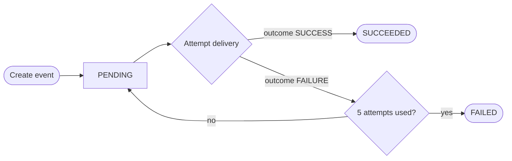
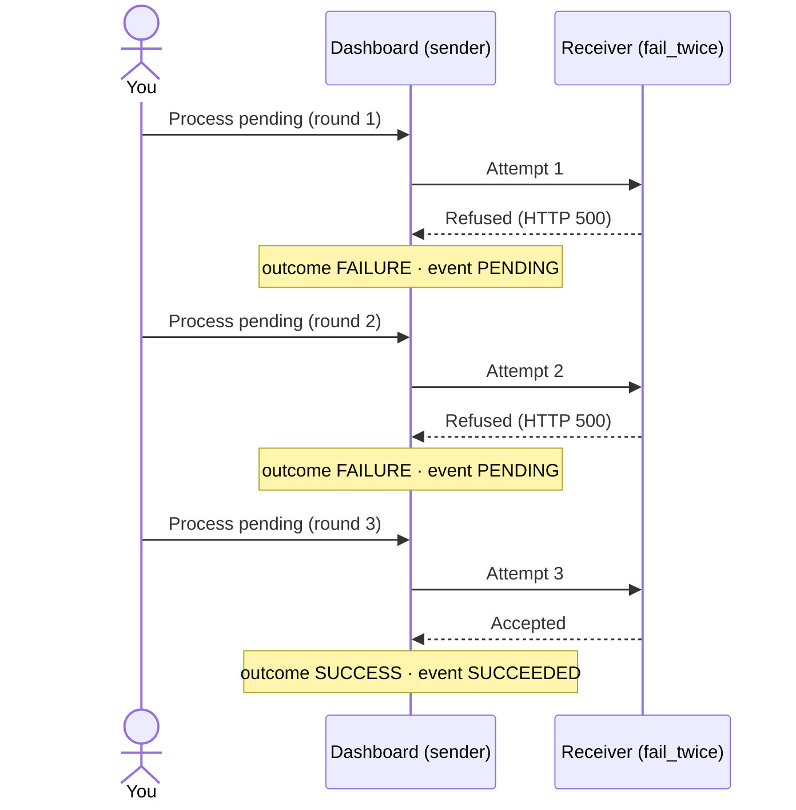
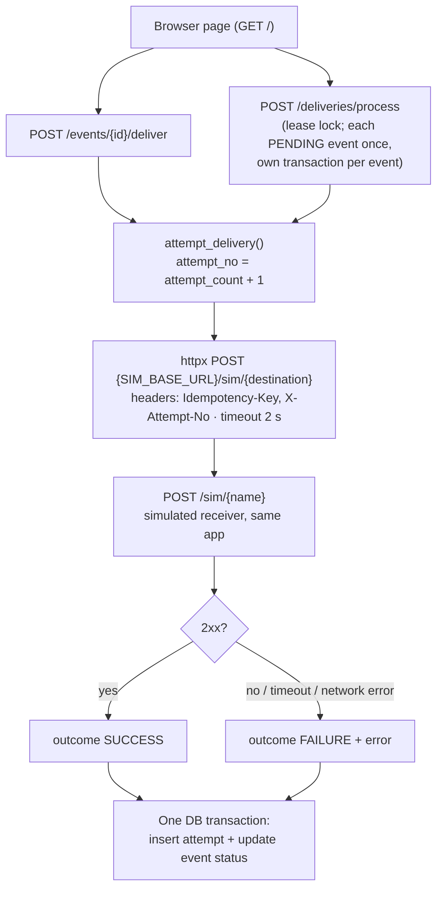

# Webhook Delivery Dashboard

**Live app:** https://webhook-dashboard-2x9d.onrender.com · no login needed · API docs at `/docs`
Free hosting: the first visit after ~15 minutes idle takes 30–60 seconds while the server wakes up. The deployment stays up; it does not expire.

**Jump to:** [Try it](#try-it-in-2-minutes) · [Requirements](#requirements-checklist) · [Statuses](#how-statuses-work) · [Run locally](#run-the-app-and-tests-locally) · [Architecture](#architecture-and-data-model) · [Retries & guarantees](#retry-policy-and-delivery-guarantees) · [Limitations](#known-limitations-and-production-changes) · [AI usage](#ai-usage)

---

## What is this?

When something happens in one system (say, an order is placed), it often has to tell another system. That message is an **event**; sending it is a **delivery**.

Deliveries don't always work the first time: the receiver may be down, refuse it, or be too slow. This app is a careful sender:

- it **records every delivery attempt** (time, outcome, error);
- a failed attempt is **retried**, up to **5 attempts in total**, then it gives up;
- a receiver that takes **more than 2 seconds** counts as a failed attempt (timeout);
- submitting the **same event twice does not create a duplicate**;
- everything is stored in a database, so it survives page refreshes and restarts.

Four simulated receivers are built in, so every scenario can be tested in the browser:

| Destination | Behaviour | End result |
|---|---|---|
| `always_succeed` | Accepts every delivery | `SUCCEEDED` on attempt 1 |
| `fail_twice` | Refuses attempts 1 and 2, accepts from attempt 3 | `SUCCEEDED` on attempt 3 |
| `always_fail` | Refuses every delivery | `FAILED` after 5 attempts |
| `always_timeout` | Answers after 5 s — longer than the 2 s limit | `FAILED` after 5 attempts, each `timeout after 2s` |

---

## Try it in 2 minutes

The page starts with four seed events, one per destination: `seed-always-succeed`, `seed-fail-twice`, `seed-always-fail`, `seed-always-timeout`.

1. Click **Reset demo** for a clean start.
2. Click **Process pending** (round 1). While it runs (~2 s, because `seed-always-timeout` waits for its timeout), click **Process pending** in a second browser tab → that tab gets `HTTP 409 process_already_running`. Only one round runs at a time.
3. Click **Process pending** twice more (rounds 2–3). Click **History** on the `seed-fail-twice` row: `FAILURE`, `FAILURE`, `SUCCESS` — the event is `SUCCEEDED`. (`seed-always-succeed` was `SUCCEEDED` after round 1.)
4. Click **Process pending** twice more (rounds 4–5). `seed-always-fail` and `seed-always-timeout` are now `FAILED`. **History** on `seed-always-timeout` shows `timeout after 2s` five times.
5. **Duplicates:** in **Create event**, create an event (`HTTP 201`). Copy its `event_id` from the response into the `event_id` box (the box gets a fresh id after each create) and click **Create event** again → `HTTP 200`, `"duplicate": true`. Change the payload and submit the same id again → `HTTP 422 event_id_reused_with_different_payload`.
6. **Deliver** `seed-always-succeed` → `HTTP 409 already_succeeded`; no new attempt.
7. Refresh the page: everything is still there.

---

## Requirements checklist

| # | Requirement (from the brief) | How it's met | See it |
|---|---|---|---|
| 1 | Create an event with a unique ID and JSON payload | Client chooses `event_id` (unique in the DB); payload must be a JSON object | **Create event** |
| 2 | Three simulated destinations | `always_succeed`, `fail_twice`, `always_fail` — plus `always_timeout` to show timeouts | Destination drop-down |
| 3 | Attempt delivery; view status and history (timestamps, outcomes, errors) | **Deliver** makes one attempt; every attempt is stored with time, outcome, error | **History** on any row |
| 4 | Bounded retries; a button that processes pending deliveries | 5 attempts in total (`MAX_ATTEMPTS`); **Process pending** = one attempt for every `PENDING` event | Steps 2–4 above |
| 5 | Duplicate submissions; defined behaviour for same ID + different payload | Same ID + same payload → `200`, existing event, `duplicate: true`. Same ID + different payload → `422`, original unchanged | Step 5 above |
| 6 | Survive refreshes and restarts | PostgreSQL; an attempt is saved only after it finishes, so a restart mid-delivery leaves the event `PENDING` and it is retried | Step 7 above |
| — | Simulated destinations inside the app | One route, `POST /sim/{name}`, in the same app | — |
| — | FastAPI, REST, PostgreSQL, bounded retries, delivery timeouts | FastAPI + SQLAlchemy + Neon Postgres; 2 s timeout on every delivery | — |
| — | Simple browser UI | One plain HTML page | Live app |
| — | Tests: duplicates, retry limit, failed → successful | `pytest` suite (see [Tests](#run-the-app-and-tests-locally)) | — |
| — | Seeded examples and reset | 4 seed events; **Reset demo** | Step 1 above |
| — | HTTPS URL, free hosting, no credentials | Render + Neon free tiers; no login | — |

---

## How statuses work

There are **two different results** — this is the easy one to misread:

- each **attempt** has an **outcome**: `SUCCESS` or `FAILURE` (with the error), shown in **History**;
- the **event** has one **status**: `PENDING`, `SUCCEEDED` or `FAILED`, shown in the events table.

A failed attempt does **not** make the event `FAILED`. The event stays `PENDING` until an attempt succeeds or all 5 attempts are used.



| Event status | Meaning | Attempted again? |
|---|---|---|
| `PENDING` | Not delivered yet (no attempt yet, or every attempt so far failed with attempts left) | Yes — next **Deliver** or **Process pending** |
| `SUCCEEDED` | An attempt succeeded | No — done |
| `FAILED` | All 5 attempts failed | No — final |

### Example: `fail_twice`, clicking **Process pending** three times



---

## Assumptions

Decision numbers (D…) refer to [`SPEC.md`](SPEC.md).

- **The client chooses the `event_id`.** The same ID always means the same event. (D10, D11)
- **Events can't be edited.** The same ID with a different payload is refused (`422`, following the IETF Idempotency-Key draft), so a retry always sends exactly what the first attempt sent. (D2, D10)
- **One destination per event**, chosen at creation. (D6, D13)
- **Creating an event doesn't send it.** Delivery happens only on **Deliver** or **Process pending**, so each step is visible. (D5)
- **Every failure is treated as temporary** and retried up to 5 attempts in total; no "permanent error" fast-fail. (D14, D18)
- **Retries run when you click**, with no wait between them (no backoff). A production system would use a background worker with increasing delays. (D20, D24)
- **Only one Process pending round at a time**, across all tabs and users. (D21)
- **No login.** Anyone with the link can create events or reset the demo; everyone shares the same data. (D8, D27)
- `event_id` may contain only letters, digits, `-` and `_` (it is used in URLs). (D16)

---

## The page, section by section

| Section | What it does |
|---|---|
| **Create event** | An `event_id` is pre-filled; edit the payload (JSON), pick a destination, click **Create event**. |
| **Deliver** | Type an `event_id` → one delivery attempt now. |
| **Event history** | Type an `event_id` → the event and all its attempts. |
| **Process pending** | One attempt for every `PENDING` event; shows how many `succeeded`, `failed` (gave up) and are `still_pending`. |
| **Reset demo** | Deletes everything and restores the 4 seed events. |
| **Events table** | All events: status, number of attempts, payload. **History** opens a row's attempts right under it (click again to close). |

Every action shows its **HTTP code** and response. `2xx` = it worked; `4xx` = refused, and `error` says why.

<details>
<summary><b>All responses, case by case</b> (click to expand)</summary>

**Create event**

| Case | HTTP | Response |
|---|---|---|
| New `event_id` | `201` | The event, `PENDING`, 0 attempts |
| Same `event_id`, same payload and destination | `200` | Existing event with current status, `"duplicate": true`; nothing stored |
| Same `event_id`, different payload or destination | `422` | `event_id_reused_with_different_payload`; original unchanged |
| Different `event_id`, same payload | `201` | A separate event (the ID identifies the event, not its payload) |
| Missing field, payload not a JSON object, unknown destination, empty or invalid `event_id` | `422` | `detail` lists what's wrong |
| Payload box isn't valid JSON | — | Message on the page; nothing sent |

**Deliver**

| Case | HTTP | Response |
|---|---|---|
| `PENDING` event, attempt succeeds | `200` | outcome `SUCCESS`, event `SUCCEEDED` |
| `PENDING` event, attempt fails, attempts left | `200` | outcome `FAILURE` + error, event stays `PENDING` |
| `PENDING` event, 5th attempt fails | `200` | outcome `FAILURE` + error, event `FAILED` |
| Event already `SUCCEEDED` / `FAILED` | `409` | `already_succeeded` / `already_failed`; no attempt |
| Unknown `event_id` | `404` | `not_found` |
| Same event delivered from two tabs at the same moment | `200` / `409` | One wins; the other gets `delivery_conflict` |

A failed attempt still returns `200`: the request worked, and the receiver's refusal is recorded as the outcome.

**Errors you can see on a failed attempt:** `HTTP 500` (receiver refused), `timeout after 2s` (receiver too slow), `request error: …` (receiver unreachable).

**Other actions**

| Case | HTTP | Response |
|---|---|---|
| History, known / unknown `event_id` | `200` / `404` | Event + attempts / `not_found` |
| Process pending | `200` | `{processed, succeeded, failed, still_pending}` (all `0` if nothing is pending) |
| Process pending while another round runs | `409` | `process_already_running`; no attempts |
| Reset demo | `200` | `{"reset": true, "seeded": 4}` |
| Database unreachable (any action) | `503` | `database_unavailable` |

</details>

---

# For developers

Full spec, all decisions (D1–D28) and the detailed AI log: [`SPEC.md`](SPEC.md).

## Run the app and tests locally

Windows / PowerShell (Python 3.13):

```powershell
python -m venv .venv
.\.venv\Scripts\Activate.ps1
pip install -r requirements.txt
copy .env.example .env   # set DATABASE_URL and TEST_DATABASE_URL (two Postgres databases)
uvicorn app.main:app --reload     # http://127.0.0.1:8000  (UI)  ·  /docs
pytest
```

Settings (`.env.example`): `DATABASE_URL`, `TEST_DATABASE_URL`, `MAX_ATTEMPTS` (5); optional `DELIVERY_TIMEOUT_SECONDS` (2), `SIM_SLOW_SECONDS` (5), `SIM_BASE_URL` (default `http://127.0.0.1:$PORT`).

**Tests** run against a separate database; every test starts from empty tables. They cover: duplicates (identical, reordered keys, different payload, `true` vs `1`, different destination), input validation, single delivery, the retry limit via **Deliver** and via **Process pending**, fail → fail → success, `409` on finished events, Process counts, the lock (held / expired), `MAX_ATTEMPTS` config, HTTP outcomes (500, timeout, request headers), seed and reset, and the UI page.

**Deploy (Render free tier):** build `pip install -r requirements.txt`; start `uvicorn app.main:app --host 0.0.0.0 --port $PORT`; env `DATABASE_URL` (Neon), `PYTHON_VERSION=3.13.7`. Auto-deploys from `main`.

## Architecture and data model

One FastAPI app, one PostgreSQL database (Neon), one static HTML page.



| Table | Columns | Rules |
|---|---|---|
| `events` | id, **event_id**, payload (jsonb), destination, status, attempt_count, created_at, updated_at | `event_id` unique |
| `delivery_attempts` | id, event_pk → events.id, attempt_no, attempted_at, outcome, error | unique (event_pk, attempt_no) |
| `process_lock` | id (always 1), owner, locked_until | one row = the Process pending lease |

**API:** `POST /events` · `GET /events` · `GET /events/{id}` · `POST /events/{id}/deliver` · `POST /deliveries/process` · `POST /admin/reset` · `POST /sim/{name}` · `GET /health`. Responses are listed in *All responses* above and in `/docs`.

## Retry policy and delivery guarantees

- **Bounded retries:** `MAX_ATTEMPTS` = total attempts (default 5: 1 first try + 4 retries). The failed attempt that reaches the limit sets `FAILED` in the same transaction. `FAILED` and `SUCCEEDED` are final (`409` on deliver).
- **Process pending** is the retry trigger (stand-in for a scheduler): one attempt per `PENDING` event, oldest first, each in its own transaction so one failure doesn't undo the others.
- **One round at a time:** a lease row (`process_lock`: 60 s, owner token, database clock). A second caller gets `409`; a crash mid-round can't block it forever because the lease expires.
- **Timeouts:** every delivery is an HTTP call with a 2 s timeout. Timeouts, non-2xx answers and network errors are all recorded as `FAILURE` with the reason and count toward the limit.
- **Duplicates:** decided by the database's unique constraint (`INSERT … ON CONFLICT DO NOTHING`), never check-then-insert, so simultaneous submits are safe. Payloads are compared as canonical JSON (key order ignored; `true` ≠ `1`).
- **Concurrent deliveries of one event:** unique `(event_pk, attempt_no)` lets one win; the other gets `409` (or is skipped inside a round).
- **If the app restarts during a delivery:** the attempt and status change are committed only **after** the HTTP call returns. A crash mid-call saves nothing — the event stays `PENDING` with no attempt row and is retried in the next round. There's no "in progress" state that could get stuck.
- **Guarantee: at-least-once.** If the crash happens after the receiver accepted but before the commit, the receiver gets the event again on the retry. Every request carries `Idempotency-Key: <event_id>` so a real receiver can ignore the repeat. Sending twice is preferred over never sending.

## Known limitations and production changes

**Limitations / unfinished**
- No backoff: every round retries every `PENDING` event immediately (D24).
- The Process lease isn't renewed: ~30+ events that all time out (2 s each) could outlast its 60 s.
- No end-to-end timeout test: tests run the app in-process, where httpx timeouts don't apply, so the timeout path uses a faked `TimeoutException`; the real timeout was checked on the live app.
- The DB transaction stays open during the HTTP call (up to the timeout), holding a pooled connection.
- Error responses aren't documented in `/docs`; reset is public; one destination per event; tables via `create_all` (no migrations); only `MAX_ATTEMPTS` is validated at startup.

**For production I would**
- Replace the button with a background worker using exponential backoff with jitter; claim events with `FOR UPDATE SKIP LOCKED` and make the HTTP call outside the DB transaction, so several workers can share the load.
- Add an `endpoints` table (customer URL, signing secret, HMAC-signed payloads) and a `deliveries` table for several destinations per event.
- Fail fast on permanent errors (4xx except 408/429) via a per-attempt `retryable` flag; add a replay endpoint for `FAILED` events.
- Use Alembic migrations, authentication on admin endpoints, and metrics/alerts on failure rates.

## AI usage

**Tools:** Claude (chat) for design review; Claude Code (VS Code) for implementation.

**How I worked.** I didn't build from the AI's first all-in-one spec. I split the work into five phases, and for each one: reviewed and corrected the spec before any code → approved Claude Code's file plan → read every diff, ran `pytest`, tested the live URL → next phase.

**A suggestion I rejected.** The AI said **Process pending** needed no lock, only a disabled button. A disabled button protects one tab, not two browsers clicking at once. I required a server-side lock, and chose a lease row that expires so a crash can't block it (a plain flag would stay stuck). Tests T22/T23.

**Other decisions I made**

| The AI suggested | I did |
|---|---|
| `409` for same ID + different payload | `422`, per the IETF Idempotency-Key draft |
| A `payload_hash` column | Dropped it; compare canonical JSON |
| Map all database errors to `503` | Only connection errors |
| Cut timeouts to save time | Kept them (they're in the brief); cut backoff |
| A fixed limit of 5 attempts | Configurable `MAX_ATTEMPTS` |
| `response_model` on every route | Skipped it; those routes return several shapes |

**How I checked.** I confirmed files actually changed instead of trusting "done", and made reviews point to the actual code. I added `Literal` status types and an `event_id` format rule by hand. Testing the app as a user led me to rename `slow` → `always_timeout`, add per-row history and a payload column, and clarify statuses in this README.

Claude's reviews of Claude Code's plans also caught a stale status check, the lock's transaction boundaries, the order of timeout error handling and id reuse on reset; I applied and verified each. Full dated log: [`SPEC.md`](SPEC.md).